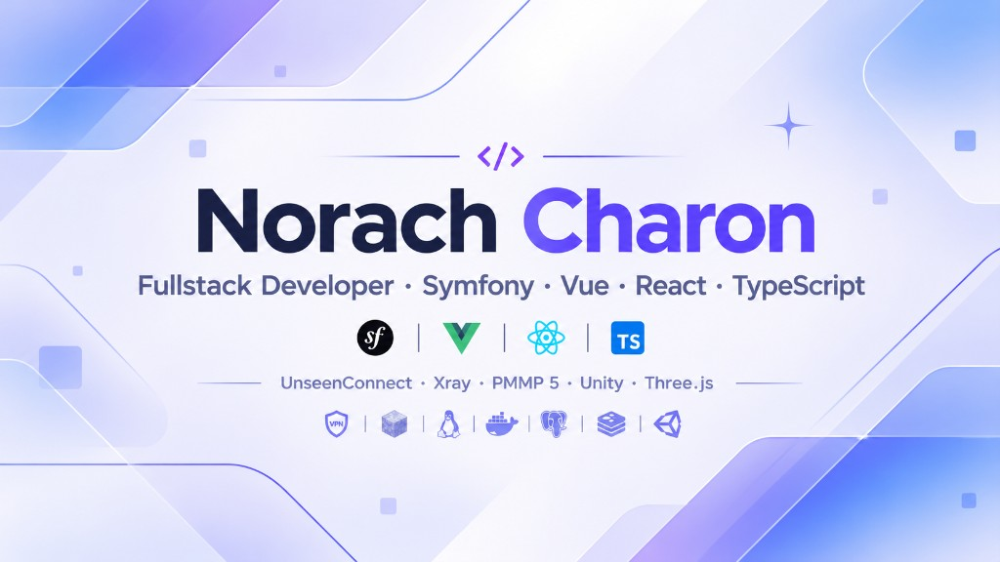

 

## О себе

Fullstack: **Symfony** на бэке, **Vue** / **React** + **TypeScript** на фронте. Публично веду **[UnseenConnect](https://github.com/UnseenConnect)** (Xray, Android / Windows / Linux). Остальное — VPN-инфра, **PMMP 5**, **Unity** / **Three.js** — в private.

## Направления

| | |
| --- | --- |
| **Сайты** | API, админки, SPA, PostgreSQL, Redis, Docker |
| **UnseenConnect** | Подписки, TUN, Reality / VMess / Trojan |
| **Bedrock** | Плагины и ядро **PocketMine-MP 5.x** |
| **Игры** | **Unity** и **Three.js** (web 3D, idle / city-sim) |

## Публичные репозитории

| Платформа | Репозиторий |
| --- | --- |
| Android | [UnseenConnect/unseenconnect-android](https://github.com/UnseenConnect/unseenconnect-android) |
| Windows | [UnseenConnect/unseenconnect-desktop](https://github.com/UnseenConnect/unseenconnect-desktop) |
| Linux | [UnseenConnect/unseenconnect-linux](https://github.com/UnseenConnect/unseenconnect-linux) |

## Stack

 

Three.js — отдельной иконки на skillicons нет

## Активность

 

