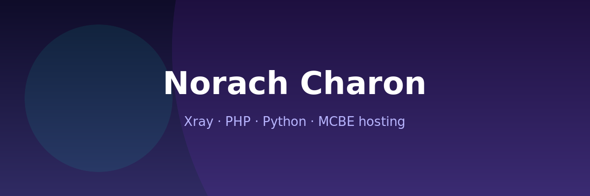
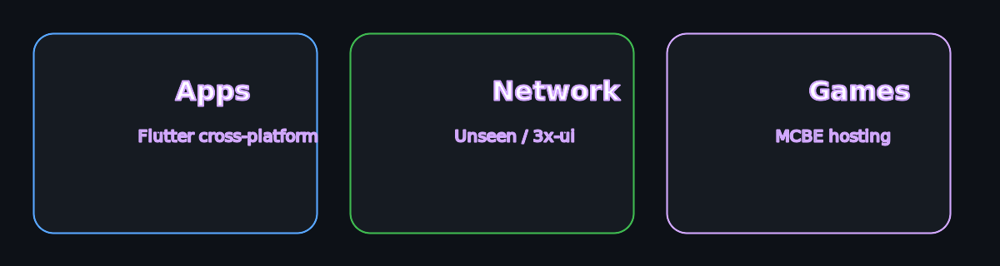

 

 

## О себе

**Fullstack-разработчик Norach Charon.** Делаю **сайты и веб-сервисы целиком**: от API и БД до интерфейса в браузере.

Публично на GitHub — экосистема **[UnseenConnect](https://github.com/UnseenConnect)** (VPN-клиенты **Android** / **Windows** / **Linux** на **Xray**). Остальное — VPN-инфра, **Bedrock PMMP5**, игры — в основном в private-репозиториях.

## Fullstack · сайты

| Слой | Технологии | Задачи |
| --- | --- | --- |
| **Backend** | **Symfony**, **PHP**, Doctrine, Messenger | REST/JSON API, авторизация, админки, интеграции, очереди |
| **Frontend** | **Vue** или **React** + **TypeScript** | SPA, панели, личные кабинеты, формы, real-time UI |
| **Данные** | **PostgreSQL**, **Redis** | Миграции, кэш, сессии, фоновые job |
| **Деплой** | **Nginx**, **Docker**, Linux | CI/CD, staging/prod, мониторинг |

Пишу **сайты под ключ**: Symfony на сервере, Vue или React с TypeScript на клиенте — единый стек без разрыва между фронтом и бэком.

Также веду **Minecraft Bedrock (PMMP 5.x)** — плагины и доработки **ядра PocketMine-MP**; отдельно — **Unity** и **Three.js** (браузерные и desktop-игры).

<table>
<tr>
<th width="33%">Клиенты</th>
<th width="33%">Бэкенд</th>
<th width="34%">Инфра</th>
</tr>
<tr>
<td valign="top">
Импорт подписок, системный прокси и TUN, 
пинг серверов, автообновления. 
Поддержка VLESS (Reality), VMess, Trojan.
</td>
<td valign="top">
<b>Symfony</b> + <b>PHP</b>: REST API, сайты, 
Doctrine, очереди, интеграции; 
Telegram-боты и скрипты на <b>Python</b>.
</td>
<td valign="top">
<b>Docker</b>, <b>Nginx</b>, <b>PostgreSQL</b>, <b>Redis</b>, 
bash-автоматизация, Debian/Ubuntu, 
деплой и сопровождение Linux-серверов.
</td>
</tr>
</table>

## Minecraft Bedrock · PMMP 5

| Направление | Что делаю |
| --- | --- |
| **Плагины** | Геймплей, мини-игры, экономика, UI/API плагинов под PMMP 5.x |
| **Ядро** | Форки и патчи **PocketMine-MP**: Bedrock-протокол, стабильность, расширения под свои сервера |
| **Стек** | **PHP**, события и API PMMP, профилирование, деплой `.phar` на Linux |

> PMMP5 и плагины — в private; публично на профиле закреплены VPN-клиенты UnseenConnect.

## Игры

| Стек | Что делаю |
| --- | --- |
| **Unity** | Игровые прототипы и релизы, low-poly, геймплей и UI |
| **Three.js** | WebGL в браузере, 3D-сцены, idle / city-sim и интерактив |

## Публичные репозитории

| Платформа | Репозиторий | Кратко |
| --- | --- | --- |
| Android | [**unseenconnect-android**](https://github.com/UnseenConnect/unseenconnect-android) | UnseenConnect VPN client for Android (Xray) — releases and issues |
| Windows | [**unseenconnect-desktop**](https://github.com/UnseenConnect/unseenconnect-desktop) | UnseenConnect VPN client for Windows (Xray) — releases and issues |
| Linux | [**unseenconnect-linux**](https://github.com/UnseenConnect/unseenconnect-linux) | UnseenConnect VPN client for Linux (Xray) — releases and issues |

## Stack

**Backend и мобильные клиенты**

 

**Fullstack и игры**

 

**Серверы и инструменты**

 

Three.js — в стеке веб-3D (иконки skillicons отдельно не даёт)

## GitHub

 

 

 

Профиль · <code>norachcharon/norachcharon</code> · обновляется через Git

